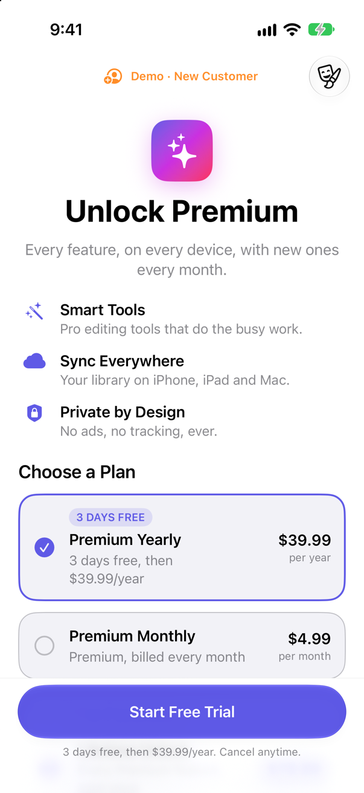
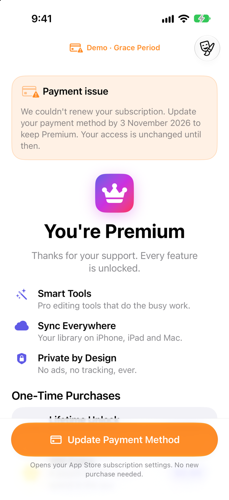
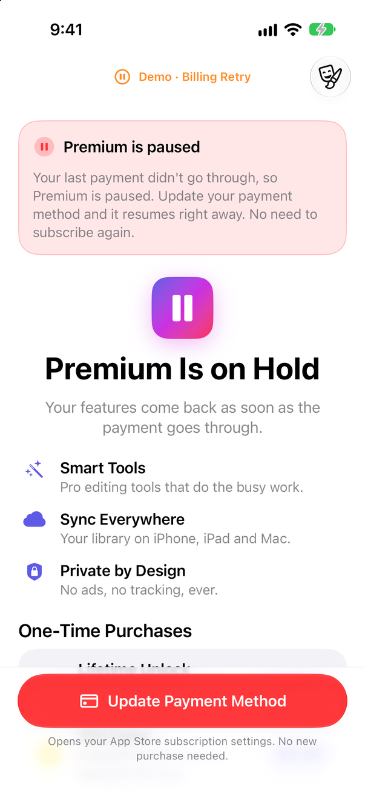
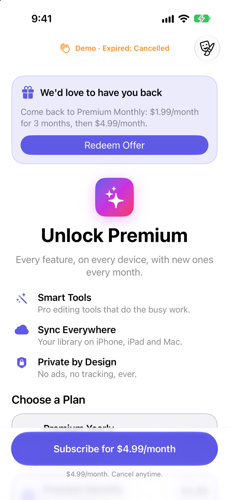

# PaywallDemo

A small SwiftUI paywall built on [RKPurchaseKit](../../README.md) 4.0. It shows that a paywall
has more to say than "subscribed or not": the App Store reports five subscription states, and
each one deserves its own screen.

| State | Access | What the paywall does |
|---|---|---|
| Subscribed | yes | Shows the renewal date and marks the current plan. |
| Grace period | yes | "Payment issue, update by <date>". Access is kept; the purchase button becomes *Update Payment Method*. |
| Billing retry | no | "Premium is paused". No plans are offered (that would sell a duplicate subscription); one button opens Apple's subscription settings. |
| Expired | no | Depends on the reason: cancelled by the customer → win-back offer; billing error → "your payment didn't go through" plus a promotional offer; declined price increase → its own message. |
| Revoked | no | "Access removed": the purchase was refunded. |

| New customer | Grace period | Billing retry | Expired, cancelled |
|---|---|---|---|
|  |  |  |  |

The screenshots are taken in demo mode (see below).

## Run it

1. Open `PaywallDemo.xcodeproj` in Xcode 26 or later.
2. Pick an iPhone simulator and press **Run**.

The shared `PaywallDemo` scheme loads `PaywallDemo.storekit` in its Run action, so StoreKit
serves the products locally. There is no App Store Connect setup, no sandbox account and no
signing team to choose. The file defines:

- the **Premium** subscription group: *Premium Monthly* ($4.99/month, with a promotional offer
  and a win-back offer) and *Premium Yearly* ($39.99/year, with a 3-day free trial),
- **100 Coins**, a consumable,
- **Lifetime Unlock**, a non-consumable,
- Billing Grace Period turned on.

The StoreKit configuration is applied by Xcode's Run action only. An app installed and
launched any other way (`simctl`, TestFlight) talks to the real App Store, finds none of these
products, and shows the "No Products" screen, which offers a way into demo mode.

### Demo mode

The theater-mask menu in the toolbar switches the paywall between **Live StoreKit** and a
simulated customer in each state: new customer, subscribed, grace period, billing retry,
expired (cancelled), expired (billing error) and revoked. Demo mode swaps
`PurchasesManager.shared` for `DemoPurchases`, a mock that conforms to `PurchasesProtocol`
and is built entirely from the kit's public model initializers. The screen code is identical
in both modes.

The mock behaves, it does not just pose: buying a plan subscribes, and *Update Payment
Method* pretends the customer fixed their card, so a grace-period or billing-retry banner
turns into "Premium is active" through `subscriptionStatusUpdates`, the same way a real
recovery arrives.

The menu also has **Simulate Ask to Buy**, which sets
`PurchaseOptions.simulatesAskToBuyInSandbox` on every purchase to show the pending message.

To start in a given state, pass a launch argument, for example in the scheme's Run options or
with `simctl launch`:

```text
-DemoScenario gracePeriod
```

Values: `live`, `newCustomer`, `subscribed`, `gracePeriod`, `billingRetry`,
`expiredCancelled`, `expiredBillingError`, `revoked`.

The same mock drives the SwiftUI previews in `PaywallView.swift`, one per state.

### Reproduce the states with real StoreKit

With the app running from Xcode in **Live StoreKit** mode:

1. Buy a plan in the app.
2. Open `PaywallDemo.storekit` and turn on **Editor → Enable Billing Retry on Renewal**. With
   **Editor → Subscription Renewal Rate** set to a fast rate, the next renewal fails within
   seconds. Billing Grace Period is already on in this file, so the subscription first enters
   the **grace period**, then **billing retry** once the grace period ends.
3. Open **Debug → StoreKit → Manage Transactions** to drive the rest from the transaction
   list: resolve the billing issue to recover the subscription, cancel it to let it **expire**
   with `autoRenewDisabled`, or refund it to see it **revoked**.

The paywall updates on its own each time, because it listens to `subscriptionStatusUpdates`
and `purchasedProducts`.

## Where each API is used

| API | Where |
|---|---|
| `PurchasesManager.configure(identifiers:)` | `PaywallDemoApp.swift`, once at launch |
| `PurchasesProtocol` | `PurchasesBackend.swift` refines it with the two streams and `showManageSubscriptions(in:groupID:)`; `DemoPurchases.swift` conforms |
| `requestProducts(includingCache: false)` | `PaywallModel.load()` |
| `StoreProduct.displayPrice`, `subscriptionPeriod`, `introductoryOffer` | `ProductViews.swift`, phrased by `OfferText.swift` ("3 days free, then $39.99/year") |
| `isEligibleForIntroOffer(inGroup:)` | `PaywallModel.refreshStatus()`; the trial is advertised only to eligible customers |
| `subscriptionStatus(inGroup:)`, `StoreSubscriptionStatus` | `PaywallModel.refreshStatus()`, decided in `SubscriptionBanner.swift` |
| `subscriptionStatusUpdates`, `purchasedProducts` | `PaywallModel.observeChanges()` |
| `purchase(productID:options:)`, `PurchaseOptions` | `PaywallModel.purchase(_:offer:)`: win-back (`winBackOfferID`), promotional (`promotionalOffer`), Ask to Buy (`simulatesAskToBuyInSandbox`) |
| `catch PurchasesError.purchaseCancelled` / `.purchasePending` | `PaywallModel.purchase(_:offer:)`: cancel is silent, pending shows a message, anything else shows `localizedDescription` |
| `restore()` | `PaywallModel.restore()` |
| `showManageSubscriptions(in:groupID:)` | `PaywallModel.manageSubscription()`, from the grace-period and billing-retry banners |
| `entitlementProductIDs()` | `PaywallModel.refreshStatus()`, for the lifetime unlock |

Promotional offers need a signature from your server, made with your In-App Purchase key,
which must never ship in an app. `PromotionalOfferSigner` in `PaywallModel.swift` marks that
spot: in demo mode it returns a placeholder, in live mode it explains what is missing. See
[Subscriptions](../../Sources/PurchaseKit/RKPurchaseKit.docc/Subscriptions.md) for the full
flow.
